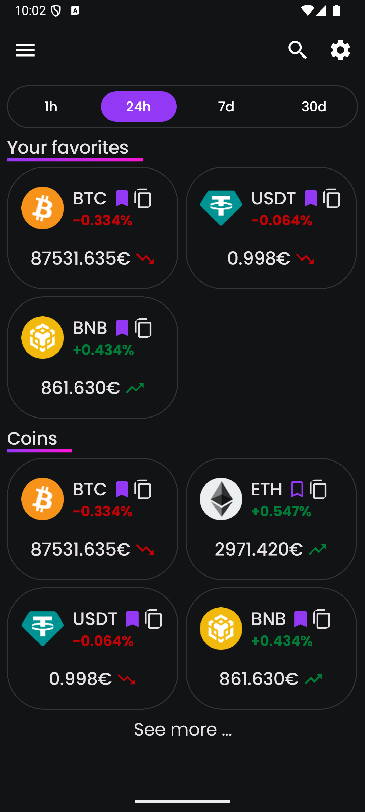
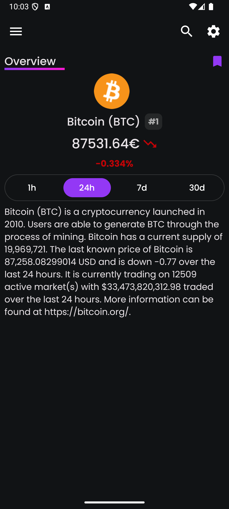
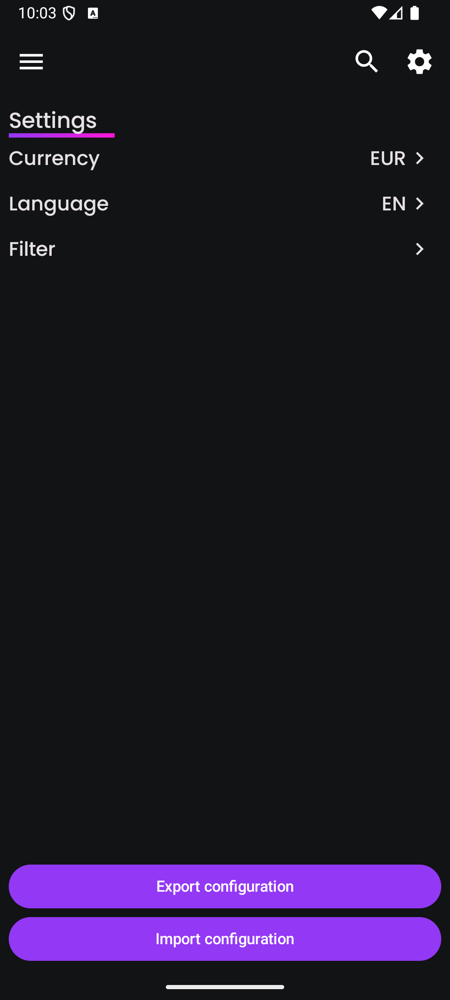
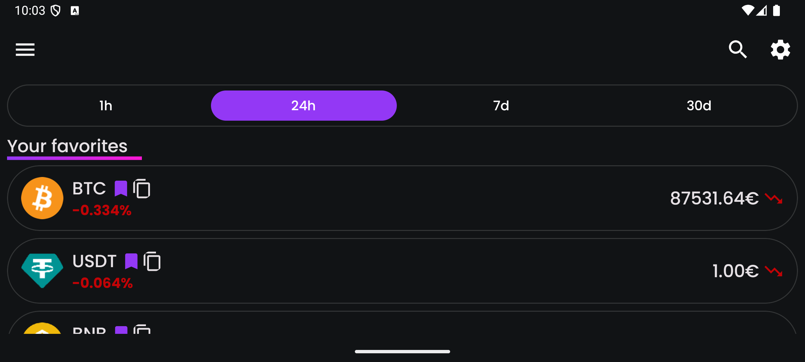
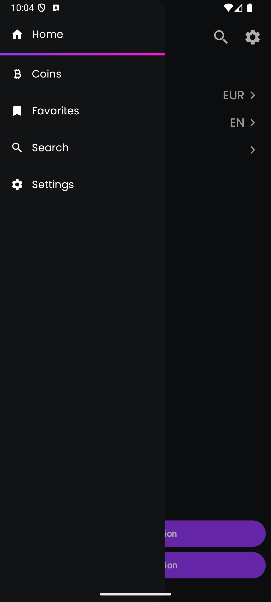
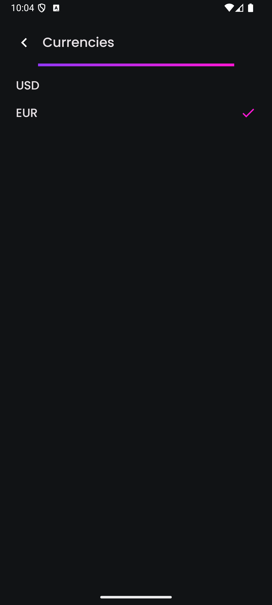
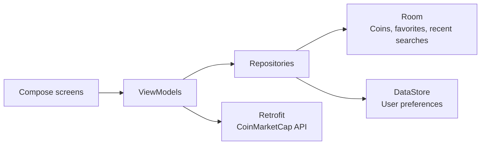

<div align="center">

# CoinAnalyzer

**The crypto market in your pocket: clean, fast, and still there when your connection isn't.**

A native Android app built with Kotlin and Jetpack Compose. Follow live prices, keep your favorite coins one tap away, and carry your setup from one device to the next.


[](LICENSE)

<br>


&nbsp;&nbsp;

&nbsp;&nbsp;


</div>

## Why CoinAnalyzer?

- **See the market at a glance.** Every coin card shows its price, its trend, and a color-coded change, so you can read the market in seconds.
- **Switch timeframes instantly.** Jump between 1h, 24h, 7d, and 30d with an animated selector. Your choice is remembered.
- **Keep your coins close.** Bookmark the ones you follow and they appear right at the top of your home screen.
- **Stay informed offline.** The latest data is stored on your device, so the app still has something to show when the network drops.
- **Make it yours.** Choose USD or EUR, English or French, and how your results are sorted.
- **Take your setup with you.** Export your preferences and favorites to a JSON file, then import them on any device.

## A closer look

### Designed for both orientations

Hold your phone upright for a compact grid. Turn it sideways and the coins switch to a wide list, with no setting to change.

<p align="center">
  
</p>

### Everything else, one tap away

<table>
  <tr>
    <th width="33%">Navigation</th>
    <th width="33%">Currencies</th>
    <th width="33%">Coin details</th>
  </tr>
  <tr>
    <td></td>
    <td></td>
    <td></td>
  </tr>
  <tr>
    <td>Reach Home, Coins, Favorites, Search, and Settings from a simple side menu.</td>
    <td>Pick your display currency and every price updates to match.</td>
    <td>Open any coin to see its rank, price, performance, and description.</td>
  </tr>
</table>

## Features

| | |
|---|---|
| **Live market data** | Prices and percentage changes from the CoinMarketCap API |
| **Pull to refresh** | Swipe down on Home, Coins, or Favorites to update prices |
| **Favorites** | Saved locally and shown on the home screen |
| **Search** | Find a coin by typing, with your recent searches kept for later |
| **Sorting** | Order coins by price or rank, ascending or descending |
| **Offline fallback** | The last fetched data loads automatically when the API can't be reached |
| **Portable config** | Export and import currency, time interval, sorting, and favorites |
| **Quick copy** | Copy a coin's name to the clipboard from its card |
| **Localization** | Full English and French support |

## Tech stack

| Area | Tools |
|---|---|
| **Language** | Kotlin |
| **UI** | Jetpack Compose, Material 3, Navigation Compose |
| **Networking** | Retrofit, Moshi |
| **Local storage** | Room, Preferences DataStore |
| **Images** | Coil |
| **Build** | Gradle Kotlin DSL, version catalog, KSP |

## Architecture

CoinAnalyzer separates the UI from its data using ViewModels and repositories. Screens observe state from ViewModels, so they update automatically whenever the data changes.



Each successful API response is saved to Room. If a request fails or comes back empty, the app loads the saved data instead.

## Getting started

### Prerequisites

- Android Studio
- A device or emulator running Android 13 (API 33) or later
- A [CoinMarketCap API key](https://coinmarketcap.com/api/)

### Installation

1. Clone the repository:

   ```bash
   git clone https://github.com/nicolasp025/CoinAnalyzer.git
   ```

2. Add your API key to `local.properties` at the project root:

   ```properties
   API_KEY=your_coinmarketcap_api_key
   ```

3. Open the project in Android Studio and run the `app` configuration, or build and install it from the command line:

   ```bash
   ./gradlew installDebug
   ```

## About the project

CoinAnalyzer was created by **Nicolas Potel** as part of the TAC course in the first year of a master's degree (M1), 2025–2026. The development history is documented week by week in the [project journal](journal.md) (in French).

## License

CoinAnalyzer is released under the [MIT License](LICENSE).

---

<div align="center">

Market data provided by [CoinMarketCap](https://coinmarketcap.com/). CoinAnalyzer is an independent project, not affiliated with CoinMarketCap, and does not provide financial advice.

</div>
